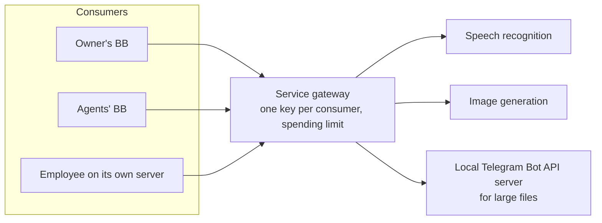
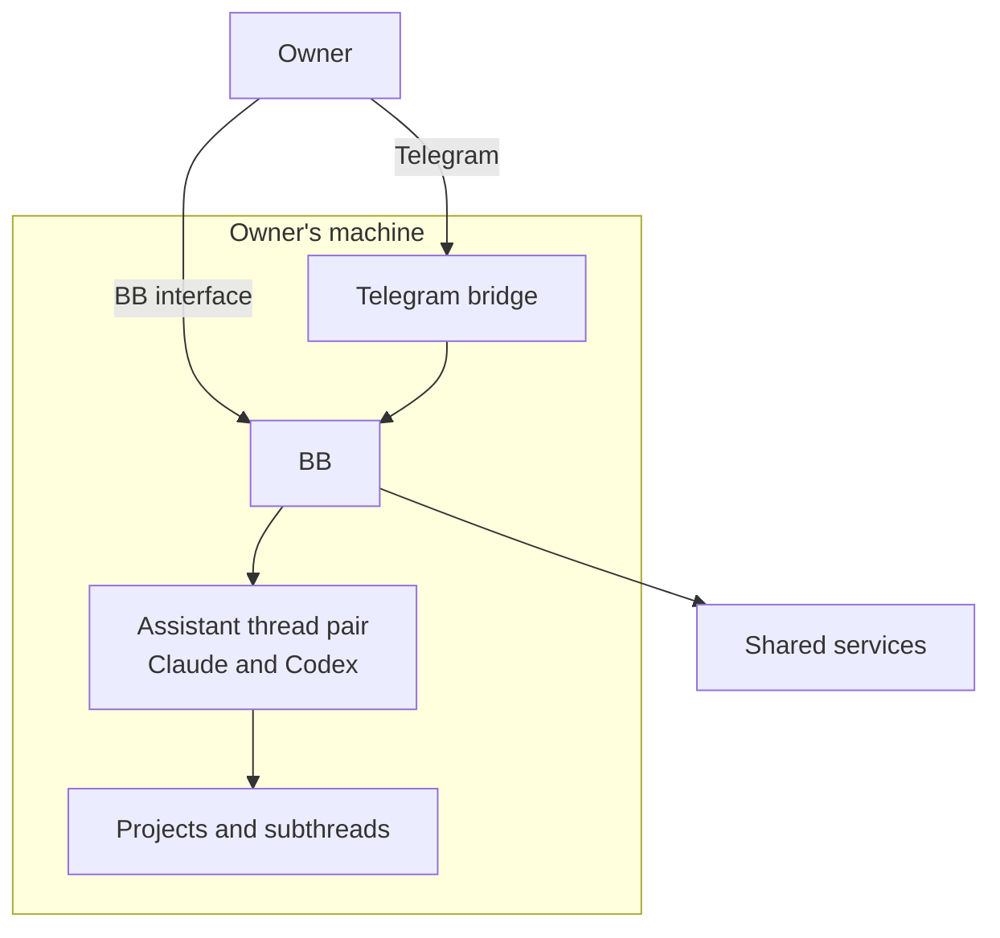
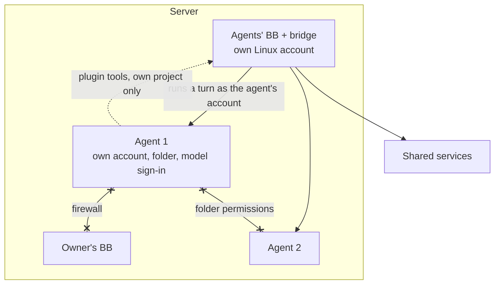
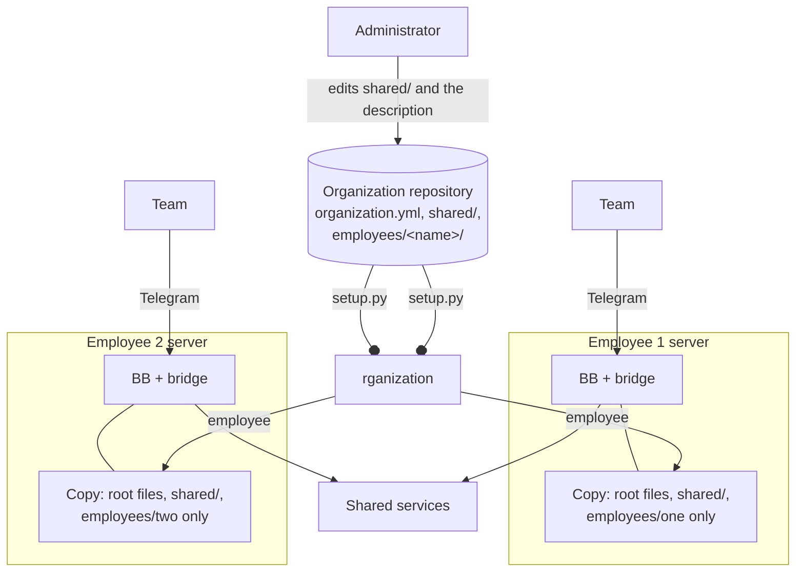

# Roadmap: deployment schemes

One platform, a few building blocks. Every installation is assembled from them by description files, not by
different code. Platform code arrives as a release; what makes an installation what it is lives in its description.

## Shared services: outside any single BB

| What | Where it lives |
|---|---|
| Services and their gateway | a server of the owner or organization, each service under its own Linux account |
| Paid model access used by a service | inside the service only; never handed to consumers |
| A consumer's key | in the consumer installation's secrets; revoked in the service settings |
| Which services an installation needs | its description (repository), without keys |

Personal connections (the owner's Telegram account, browser, personal MCP logins) stay with the owner's assistant and
are not shared.

## Three cases, two different protections

| Case | Who talks to whom | Where it runs | Protects against | With |
|---|---|---|---|---|
| Personal assistant | one owner, sometimes other people | the owner's BB, next to the owner's projects | a stranger in a chat reaching the owner's conversations | guest thread guard |
| Organization employee | one agent, many team members; the owner is administrator | its own BB under its own account | a member reaching someone else's private chat | guest thread guard |
| Assistants of other people | each person has an agent in private and own groups | one shared agents' BB; each agent under its own Linux account | an agent reaching another agent or the server owner's BB | per-agent locks: account, folder permissions, firewall |

The guest thread guard solves "one agent, many people". Per-agent locks solve "many agents, one server". They do not
replace each other and are combined when both apply. The model is reached the same way everywhere: ordinary Claude Code
and Codex signed in once on the machine.

## A. Personal assistant in its own BB

| What | Where it lives |
|---|---|
| Platform | BB plugins from this repository, updated by release |
| Role, rules, connections | the assistant's private repository |
| Memory and conversations | BB and bridge data on the owner's machine |
| Secrets | on the machine, outside git |

## B. Several independent agents on one server

| What | Where it lives |
|---|---|
| Platform | plugins of the agents' BB; accounts, firewall and permissions set by the installer |
| An agent's configuration | its folder and its repository (or a folder of an organization repository) |
| An agent's memory and conversations | its project in the agents' BB; closed to other agents |
| Secrets of an agent | its folder, readable by its account only |

## C. Organization: employees described in one repository

| What | Where it lives |
|---|---|
| Platform | shared, by release |
| The organization: time zone, platform version, employees, shared services | `organization.yml` |
| Rules and skills common to all employees | `shared/` — the administrator edits them |
| One employee: role, own skills, working documents, `employee.yml` | `employees/<name>/` |
| Secrets, sign-ins, conversations, memory | on each employee's server, never in the repository |

Format and layout: [organization.md](organization.md). Installation: [install.md](install.md). Moving an existing
employee repository in: [migration.md](migration.md). A single employee with its own repository is the same case with
one employee; that mode keeps working.

## The Docker analogy

| Docker | This platform |
|---|---|
| Engine: installed as a build, users do not need its sources | Platform: BB plugins and the installer, delivered as a release |
| A container is described by a file | An employee is described by `employee.yml` and its folder |
| A set of containers is described by one file | An organization is described by `organization.yml` |
| Secrets are not in the description | Keys and sign-ins are not in the description: they stay on the installation |

Everything that makes an installation what it is should be written in its description, not done by hand on a server.
The three schemes above are three kinds of descriptions, not three products.

## Stages

1. Personal assistant and one employee on the same release — done.
2. Organization repository: an employee installed from `employees/<name>`, shared rules and skills, the installer
   compares the description with the installation — this release.
3. Several agents on one server under per-agent locks.
4. Shared services behind one gateway with a key per consumer.
5. Organization hub: an administration view over the organization repository and the employees' state.
